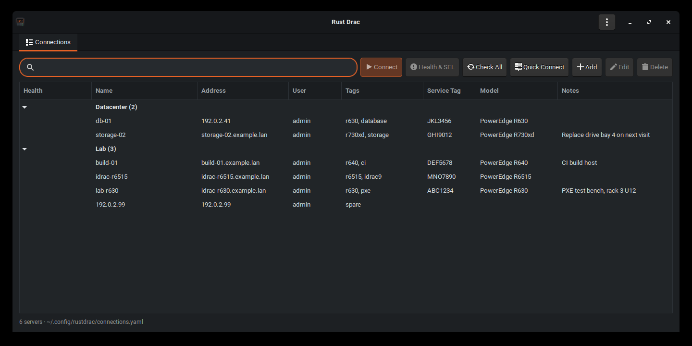

<div align="center">


# Rust Drac

**A fast, native Linux and Windows app for Dell iDRAC 8 & 9 and Supermicro X11 servers. Made with Rust 🦀**

Virtual console in tabs · address book · health & SEL viewer · background alarms.<br>
No browser, no Java, no login page, no certificate warnings.

[](https://github.com/karubits/rustdrac/actions/workflows/ci.yml)
[](https://github.com/karubits/rustdrac/releases/latest)
[](https://github.com/karubits/rustdrac/releases)
[](LICENSE)
<br>
[](https://www.rust-lang.org/)
[](Cargo.toml)
[](https://www.gtk.org/)
[](#download)
[](#windows)
[](#how-it-works)
[](#supermicro-x11)

[Download](#download) · [Features](#features) · [Usage](#usage) · [Build](#build-from-source) · [Contributing](#contributing)


</div>

## Features

| | |
|---|---|
| 🖥️ **Virtual console in tabs** | The HTML5 KVM viewer of Dell iDRAC 8 and 9 and of Supermicro X11 BMCs, opened straight from the app with no login page or certificate prompt. Several servers side by side. |
| 📒 **Address book** | Groups, tags, notes, and instant search across every field. Vendor, service tag (or serial number) and model fill themselves in from Redfish. |
| ❤️ **Health & SEL** | Every component and sensor, plus the full System Event Log with filtering, search, CSV export and clearing. |
| 🔔 **Alarm checker** | Polls your servers in the background and sends a desktop notification when one turns Warning or Critical. |
| 📸 **Screenshots & log export** | One-click PNG of the console, and a zip with a hardware summary, health, SEL and the BMC's own log for support cases. |
| 🔐 **Keyring passwords** | Passwords go to GNOME Keyring or KWallet, never into the config file. |
| 🌗 **Dark by default** | A polished dark theme with an orange accent, or follow your desktop theme. |
| 📦 **One-file download** | A self-contained AppImage that runs on any recent x86-64 Linux. |

## Download

Get the latest **`rustdrac-<version>-x86_64.AppImage`** from the [Releases](../../releases/latest) page, then:

```sh
chmod +x rustdrac-*-x86_64.AppImage
./rustdrac-*-x86_64.AppImage
```

The AppImage bundles GTK 3 and WebKitGTK and runs on x86-64 Linux with glibc 2.36 or newer: Debian 12+, Ubuntu 23.04+, Fedora 37+, Arch and similar. Each release also has:
- a plain `…-x86_64-linux.tar.gz` (the binary only; it needs `webkit2gtk-4.1` installed);
- the Windows installer and portable zip (below);
- `SHA256SUMS`, to verify any download.

### Windows

```powershell
winget install karubits.RustDrac
```

or run **`rustdrac-<version>-x86_64-setup.exe`** from the [Releases](../../releases/latest) page. It installs for the current user (no administrator rights) with a Start-menu entry, and `…-x86_64-windows.zip` is the same build as a portable folder: unzip anywhere and run `rustdrac.exe`.

- Windows 10 (1809+) or 11, x64. The console uses the Microsoft Edge WebView2 Runtime, which Windows 11 and up-to-date Windows 10 already have; the installer fetches it otherwise.
- The build is not code-signed, so SmartScreen shows an "unknown publisher" prompt the first time the installer runs (**More info → Run anyway**). `winget` and `SHA256SUMS` let you verify what you got.
- Passwords go to the Windows Credential Manager; the address book is `%APPDATA%\rustdrac\connections.yaml`; screenshots land in `Pictures\Rust Drac`.

## Usage

```sh
rustdrac                                   # connection manager
rustdrac lab-r630                          # saved connection (name, address or service tag / serial)
rustdrac 192.0.2.10 -u admin -p '…'        # ad-hoc
rustdrac lab-r630 build-01                 # several tabs at once
rustdrac --health lab-r630                 # Health & SEL instead of the console
RUSTDRAC_PASSWORD='…' rustdrac 192.0.2.10  # password from the environment
```

## Connection manager



The first tab is an address book:
- **Add / Edit / Duplicate / Delete** (buttons or right-click menu). Each server has a name, address, BMC type (detected on connect, or Dell / Supermicro by hand), user, group, tags, service tag or serial, model and free-form notes.
- **Groups** are folders in the list. Tags are comma separated.
- **Search** matches every whitespace-separated term against name, address, user, group, tags, service tag / serial, model and notes. Press Enter to connect to the first match. Typing anywhere in the list jumps to the search box.
- **Vendor, service tag (Supermicro: serial number) and model** are filled in automatically from Redfish the first time you connect.
- **Quick Connect** opens a one-off console, which you can optionally add to the address book.

Each console opens in its own tab. To close one, use the tab's ✕ or the viewer's **Disconnect Viewer** button (iDRAC) or exit hotkey (Supermicro). Either way the app first disconnects the KVM the way the viewer's own button does, then logs out. Without this an iDRAC keeps the console session, and the next connect asks "A session to this device already exists. Do you want to try to share this session?" Closing the window does the same for every open tab.


## Screenshots and log export

The header bar has two actions for the server in the current tab:
- **Screenshot** (console tabs) saves the console picture as a PNG at its native resolution, without the viewer's toolbar, to `~/Pictures/Rust Drac/<name>-<service tag>-<time>.png`. To change the folder, open **Menu → Settings…** (or set `defaults.screenshot_dir`). A notice offers **Open Folder**.
- **Export Logs** (console and Health tabs, and the address book's right-click menu) saves a zip for a support case or an audit:

  | File | Contents |
  |---|---|
  | `summary.txt` / `summary.json` | Vendor, model, service tag, serial, BIOS and BMC firmware, power state, health and alarms, CPUs, DIMMs (slot, size, speed, part number), storage controllers and drives (model, size, serial), NICs (MAC, link, speed) and PSUs |
  | `health.csv` | Every component and sensor with its status and reading |
  | `sel.csv` | The full System Event Log |
  | `lclog.csv` | Dell: the newest 500 Lifecycle Controller log entries |
  | `maintenance.csv` | Supermicro: the newest 500 maintenance event log entries (who changed what, over which interface) |

  It is read over Redfish, with progress and Cancel, and contains no credentials. Expect a few seconds on iDRAC 9, about a minute on a Supermicro X11 and two to three minutes on iDRAC 8.

## Health, SEL and alarms


All of this uses Redfish with basic auth, so it doesn't take one of the BMC's few web-session slots and doesn't disturb an open console.

- **Health & SEL tab** (toolbar, right-click menu or `--health`). It shows:
  - the overall state;
  - every component (system, CPUs, memory, PSUs, voltages, fans, temperatures, storage controllers and drives), with an *Only show problems* filter;
  - the full SEL, with a severity filter, search, **Export SEL…** (CSV) and **Clear SEL…** (asks first).

  When the health rollup is in alarm but every component reads OK (a CPU machine-check error, for example), the SEL events that explain it are listed with the components.
- **Alarm checker**: the manager's Health column shows each server's state. **Check All** runs it now; it also runs at start-up and every `defaults.health_check_minutes` (default 15, 0 = off).
  - It checks every server with a saved password, plus any server whose password you entered this session.
  - Each check costs one request, and more detail is fetched only when something isn't OK.
  - A desktop notification is shown when a server becomes Warning or Critical.
  - Group rows show the worst state of their servers.

iDRAC 8 Redfish is slow: each request takes about 5s plus a ~4s TLS handshake (iDRAC 9 answers in well under a second, a Supermicro X11 in about two). Rust Drac keeps one connection per BMC, sends its requests one at a time (concurrent requests get garbage back), retries transient failures, and fills the Health tab in as results arrive. A full read of an R630 takes about a minute.

### Config file

`~/.config/rustdrac/connections.yaml` on Linux, `%APPDATA%\rustdrac\connections.yaml` on Windows (set `RUSTDRAC_CONFIG` to use another file). A config from the old `~/.config/idrac-console/` is migrated automatically. It's plain YAML, so you can copy it between machines or edit it by hand:

```yaml
defaults:
  user: admin        # used when a connection has no user
  theme: dark            # dark (default), light or system
  screenshot_dir: ~/Pictures/Rust Drac
  health_check_minutes: 15  # background alarm check; 0 = off
connections:
  - id: 3f9c1a2b7d4e5f60 # generated; links the entry to its saved password
    name: lab-r630
    address: 192.0.2.10
    group: Lab
    tags: [r630, pxe]
    service_tag: ABC1234
    model: PowerEdge R630
    vendor: dell           # dell or supermicro; learned on first connect, or set by hand
    notes: PXE test bench, rack 3 U12
    save_password: true
  - address: 192.0.2.20  # only the address is required
    user: ADMIN
    vendor: supermicro
```

On Supermicro servers `service_tag` holds the system serial number.

### Passwords

Passwords are **never written to the YAML file**. If you tick *Save password in the system keyring*, the password goes into the desktop keyring via Secret Service (GNOME Keyring or KWallet) under the service `rustdrac`, keyed by the connection `id`. Saved passwords don't travel with a copied config file; on a new machine you're asked for each password once.

## Settings and About

The menu button at the right of the header bar (☰ or ⋮, depending on your icon theme) has:
- **Settings…**: choose the screenshot folder (type a path, **Browse…**, or ↶ for the default). It is saved as `defaults.screenshot_dir` in the config file.
- **About Rust Drac**: the version, a link to the source code on GitHub, the licence, and how to contribute.

## Look

Dark mode is the default: Adwaita dark plus the app's own stylesheet with an orange accent. `--theme light` or `--theme system` (or `defaults.theme`) switch it off; `system` follows your desktop's GTK theme.

## How it works

The app first checks which web UI the BMC runs, from where `/` redirects (`/start.html` on iDRAC 8, `/restgui/start.html` on iDRAC 9) or what it serves there (a Supermicro BMC answers with its login form, which posts to `/cgi/login.cgi`), so you never pick the vendor or generation yourself. The result is saved as `vendor:` in the address book, and the Redfish paths follow from it (`Systems/System.Embedded.1` and `Managers/iDRAC.Embedded.1` on Dell, `Systems/1` and `Managers/1` on Supermicro).

### iDRAC 8

1. **Login.** `POST /data/login` returns the ST1/ST2 tokens and the session cookie. The app then reads the per-login `aimSession` id and the virtual-media privilege, and downloads the viewer's string table (`locale/locale_en.json`).
2. **Viewer.** `virtualconsolehtml5.html` opens in an embedded web view (WebKitGTK on Linux, WebView2 on Windows). Certificate errors are ignored, and each tab is ephemeral and isolated, so nothing is written to disk.
3. **Shim.** Dell's viewer expects the iDRAC web UI to have opened it, so a small injected script provides two stand-ins:
   - the opener window the viewer reads its strings from (`window.opener.top.localeObj`);
   - the certificate popup for the KVM port `:5900`, which the viewer waits on before it connects.
4. **Closing.** Closing a tab disconnects and logs out as described above.

Note: the iDRAC 8 only serves gzip-compressed static files, so a client that doesn't send `Accept-Encoding: gzip` gets a 404.

### iDRAC 9

1. **Login.** `POST /sysmgmt/2015/bmc/session`, with the user and password as quoted header values, returns the session cookie and an `XSRF-TOKEN`.
2. **Console session.** `GET /sysmgmt/2015/server/vconsole` returns the viewer URL (`/restgui/vconsole/index.html`) with the KVM session ids `VCSID`/`VCSID2` in its query.
3. **Viewer.** Dell's web UI opens the bare viewer page and passes the ids through `sessionStorage`. An injected script does the same, so the ids never appear in the URL. The viewer is noVNC over a `wss://` WebSocket on port 443.
4. **Closing.** The page is unloaded, which closes the KVM socket, and the session is deleted (`DELETE /sysmgmt/2015/bmc/session`).

### Supermicro X11

1. **Login.** `POST /cgi/login.cgi` with the user and password base64-encoded (as the login page's own script does on recent firmware; older X10/X11 firmware posts them plain, and the app checks the login page to tell), which sets the `SID` cookie.
2. **Viewer.** `/cgi/url_redirect.cgi?url_name=man_ikvm_html5_bootstrap` is the HTML5 iKVM (noVNC): a self-contained page the web UI opens in a popup, carrying a one-time KVM token and opening a `wss://` WebSocket on port 443. It opens in the embedded web view with the session cookie. If the session is gone, the BMC serves a "session timed out" stub instead; a small injected script makes that readable rather than bouncing to the login form.
3. **Closing.** The page is unloaded, which closes the KVM socket, then `GET /cgi/logout.cgi` ends the web session.

Redfish on an X11 (firmware 1.7x) has no `$expand`, `$top` or `$skip`: any query string is answered with a redirect and then HTTP 501, so the app reads collections member by member there. The SEL is `Systems/1/LogServices/Log1`; the maintenance event log (`Managers/1/LogServices/Log1`) takes the place of Dell's Lifecycle log in the export.

## Build from source

### Linux

Requires Rust 1.88+ and the GTK 3 / WebKitGTK 4.1 development files:
- Debian/Ubuntu: `sudo apt install build-essential pkg-config libgtk-3-dev libwebkit2gtk-4.1-dev libsoup-3.0-dev libdbus-1-dev` (or run `scripts/ci-deps.sh`)
- Arch: `sudo pacman -S rustup webkit2gtk-4.1`

Saving passwords needs a Secret Service provider (GNOME Keyring or KWallet).

```sh
cargo build --release   # -> target/release/rustdrac
cargo test              # add `-- --ignored` to also test against the real keyring

# install for the current user, with an app-menu entry and icon
install -Dm755 target/release/rustdrac ~/.local/bin/rustdrac
install -Dm644 packaging/rustdrac.desktop ~/.local/share/applications/rustdrac.desktop
install -Dm644 packaging/rustdrac.svg ~/.local/share/icons/hicolor/scalable/apps/rustdrac.svg
```

To build the AppImage and tarball into `dist/` (best on Debian 12, the oldest supported base):

```sh
scripts/install-tools.sh linuxdeploy appimagetool
scripts/build-appimage.sh
```

### Windows

The Windows build keeps the GTK 3 interface and shows the console in Microsoft WebView2 instead of WebKitGTK (`src/webview/`). It is built with [MSYS2](https://www.msys2.org/) (`winget install MSYS2.MSYS2`); in a **UCRT64** shell:

```sh
pacman -S mingw-w64-ucrt-x86_64-gtk3 mingw-w64-ucrt-x86_64-rust mingw-w64-ucrt-x86_64-pkgconf \
          mingw-w64-ucrt-x86_64-gcc mingw-w64-ucrt-x86_64-binutils mingw-w64-ucrt-x86_64-ntldd \
          mingw-w64-ucrt-x86_64-librsvg zip
cargo build --release   # -> target/release/rustdrac.exe (needs WebView2Loader.dll next to it, see below)
cargo test
scripts/build-windows.sh   # installer + portable zip into dist/; needs Inno Setup 6 (`winget install JRSoftware.InnoSetup`)
```

`scripts/build-windows.sh` collects the exe, `WebView2Loader.dll` (unpacked by the `webview2-com-sys` crate under `target/`), the MinGW DLLs it needs, the PNG and SVG pixbuf loaders, the Adwaita icons, the GSettings schemas and `packaging/windows/settings.ini` into a self-contained folder, then runs `packaging/windows/rustdrac.iss`. The winget manifest templates are in `packaging/winget/`; `scripts/winget-submit.ps1` fills them in and (with a token) opens the pull request on `microsoft/winget-pkgs`, which the release workflow does for every non-pre-release tag once the `WINGET_TOKEN` secret exists.

## Development

Every push and pull request runs these checks in CI (`.github/workflows/ci.yml`):

| Check | Tool |
|---|---|
| Formatting | `cargo fmt --check` |
| Lints, warnings are errors | `cargo clippy --all-targets -- -D warnings` |
| Tests | `cargo test` |
| Windows build: clippy and tests under MSYS2 (`windows-latest`) | `cargo clippy`, `cargo test` |
| Dependencies: RustSec advisories, licences (MIT-compatible only), bans, sources | `cargo-deny` (`deny.toml`) |
| Secrets in the full git history and working tree | gitleaks **and** betterleaks (`.gitleaks.toml`) |
| Shell scripts | shellcheck |

Third-party tools are pinned by version and SHA-256 in `scripts/install-tools.sh`. To run the same checks locally:

```sh
scripts/install-tools.sh cargo-deny gitleaks betterleaks
cargo fmt --check && cargo clippy --all-targets -- -D warnings && cargo test
bin/cargo-deny check
bin/gitleaks git --config .gitleaks.toml . && bin/betterleaks git --config .gitleaks.toml .
```

### Releasing

1. Add the changes under a `## YYYY-MM-DD` heading (today) at the top of `CHANGELOG.md` and commit.
2. Run `scripts/release.sh X.Y.Z`. It sets the version in `Cargo.toml`, runs the tests, commits, creates the annotated tag `vX.Y.Z` and pushes.
3. The tag starts `.github/workflows/release.yml`, which:
   - checks the tag matches `Cargo.toml`;
   - builds the AppImage and tarball and smoke-tests the AppImage;
   - publishes a release with the files and `SHA256SUMS`, using that CHANGELOG section as the notes.

Versions follow [SemVer](https://semver.org/): patch for fixes, minor for new features, major for breaking config changes.

## Debugging

| Variable | Effect |
|---|---|
| `RUSTDRAC_CONFIG=<file>` | Use another address-book file |
| `RUSTDRAC_DEVTOOLS=1` | Enables the WebKit inspector / WebView2 DevTools (right click → Inspect) |
| `RUSTDRAC_DEBUG=1` | Logs each console HTTP request and its status, plus JS console output |
| `RUSTDRAC_AUTOCLOSE=<secs>` | Closes the window after N seconds, disconnecting every console |
| `RUSTDRAC_SNAPSHOT=<file.png>` | With AUTOCLOSE, saves a PNG of the current tab before closing |
| `RUSTDRAC_SNAPSHOT_PAGE=<n>` | With SNAPSHOT, switches to tab n first (0 = Connections) |
| `RUSTDRAC_TEST_SCREENSHOT=<secs>` | Presses the Screenshot button after N seconds |

To test the log export against a real BMC (it writes `rustdrac-export-test.zip` to the temp folder; `RUSTDRAC_TEST_VENDOR=dell|supermicro` skips the vendor probe):

```sh
RUSTDRAC_TEST_HOST=… RUSTDRAC_TEST_USER=… RUSTDRAC_TEST_PASSWORD=… cargo test -- --ignored export_from_a_real_bmc --nocapture
```

## Contributing

Contributions are very welcome, from bug reports to pull requests! 🙌

- 🐛 **Found a bug or have an idea?** [Open an issue](https://github.com/karubits/rustdrac/issues). Include your BMC (iDRAC 8/9 or Supermicro X11) and firmware version, server model and what you expected.
- 🔧 **Want to fix something?** Fork the repo, make your change on a branch, and [open a pull request](https://github.com/karubits/rustdrac/pulls).
- ✅ Run `cargo fmt`, `cargo clippy --all-targets -- -D warnings` and `cargo test` before you push (see [Development](#development)).
- ⭐ **Like it?** Star the repo so other BMC wranglers can find it.

See [CONTRIBUTING.md](CONTRIBUTING.md) for the details.

## License

[MIT](LICENSE) © Karubits

<div align="center"><sub>Made with Rust 🦀, GTK, WebKitGTK and WebView2. Not affiliated with Dell Technologies or Super Micro Computer, Inc.; iDRAC and PowerEdge are trademarks of Dell Inc., Supermicro of Super Micro Computer, Inc.</sub></div>
