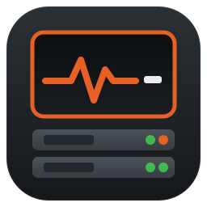
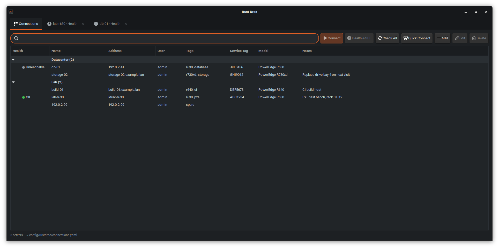
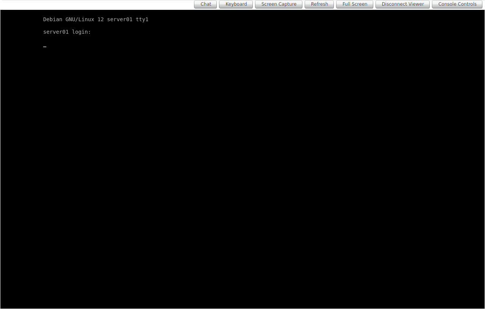
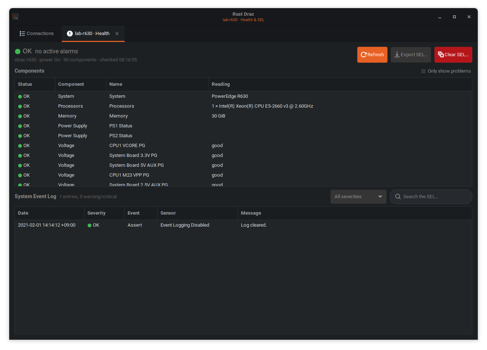

# Rust Drac

A native app for Dell **iDRAC 8** servers:
- the HTML5 virtual console in tabs, with no browser, no login page and no certificate warning;
- an address book;
- a health and System Event Log (SEL) viewer;
- a background alarm checker.

<p align="center"></p>



## Download

Get the latest **`rustdrac-<version>-x86_64.AppImage`** from the [Releases](../../releases/latest) page, then:

```sh
chmod +x rustdrac-*-x86_64.AppImage
./rustdrac-*-x86_64.AppImage
```

The AppImage bundles GTK 3 and WebKitGTK and runs on x86-64 Linux with glibc 2.36 or newer: Debian 12+, Ubuntu 23.04+, Fedora 37+, Arch and similar. Each release also has:
- a plain `…-x86_64-linux.tar.gz` (the binary only; it needs `webkit2gtk-4.1` installed);
- `SHA256SUMS`, to verify either download.

## Usage

```sh
rustdrac                                   # connection manager
rustdrac lab-r630                          # saved connection (name, address or service tag)
rustdrac 192.0.2.10 -u admin -p '…'        # ad-hoc
rustdrac lab-r630 build-01                 # several tabs at once
rustdrac --health lab-r630                 # Health & SEL instead of the console
RUSTDRAC_PASSWORD='…' rustdrac 192.0.2.10  # password from the environment
```

## Connection manager

The first tab is an address book:
- **Add / Edit / Duplicate / Delete** (buttons or right-click menu). Each server has a name, address, user, group, tags, service tag, model and free-form notes.
- **Groups** are folders in the list. Tags are comma separated.
- **Search** matches every whitespace-separated term against name, address, user, group, tags, service tag, model and notes. Press Enter to connect to the first match. Typing anywhere in the list jumps to the search box.
- **Service tag and model** are filled in automatically from Redfish the first time you connect.
- **Quick Connect** opens a one-off console, which you can optionally add to the address book.

Each console opens in its own tab. To close one, use the tab's ✕ or the viewer's **Disconnect Viewer** button. Either way the app first disconnects the KVM the way Dell's button does, then logs out. Without this the iDRAC keeps the console session, and the next connect asks "A session to this device already exists. Do you want to try to share this session?" Closing the window does the same for every open tab.



## Health, SEL and alarms



All of this uses Redfish with basic auth, so it doesn't take one of the iDRAC's few web-session slots and doesn't disturb an open console.

- **Health & SEL tab** (toolbar, right-click menu or `--health`). It shows:
  - the overall state;
  - every component (system, CPUs, memory, PSUs, voltages, fans, temperatures, storage controllers and drives), with an *Only show problems* filter;
  - the full SEL, with a severity filter, search, **Export SEL…** (CSV) and **Clear SEL…** (asks first).

  When the health rollup is in alarm but every component reads OK (a CPU machine-check error, for example), the SEL events that explain it are listed with the components.
- **Alarm checker**: the manager's Health column shows each server's state. **Check All** runs it now; it also runs at start-up and every `defaults.health_check_minutes` (default 15, 0 = off).
  - It checks every server with a saved password, plus any server whose password you entered this session.
  - Each check costs one request, and more detail is fetched only when something isn't OK.
  - A desktop notification is shown when a server becomes Warning or Critical.
  - Group rows show the worst state of their servers.

iDRAC 8 Redfish is slow: each request takes about 5s plus a ~4s TLS handshake. Rust Drac keeps one connection per iDRAC, sends its requests one at a time (concurrent requests get garbage back), retries transient failures, and fills the Health tab in as results arrive. A full read of an R630 takes about a minute.

### Config file

`~/.config/rustdrac/connections.yaml` (set `RUSTDRAC_CONFIG` to use another file). A config from the old `~/.config/idrac-console/` is migrated automatically. It's plain YAML, so you can copy it between machines or edit it by hand:

```yaml
defaults:
  user: admin        # used when a connection has no user
  theme: dark            # dark (default), light or system
  health_check_minutes: 15  # background alarm check; 0 = off
connections:
  - id: 3f9c1a2b7d4e5f60 # generated; links the entry to its saved password
    name: lab-r630
    address: 192.0.2.10
    group: Lab
    tags: [r630, pxe]
    service_tag: ABC1234
    model: PowerEdge R630
    notes: PXE test bench, rack 3 U12
    save_password: true
  - address: 192.0.2.20  # only the address is required
```

### Passwords

Passwords are **never written to the YAML file**. If you tick *Save password in the system keyring*, the password goes into the desktop keyring via Secret Service (GNOME Keyring or KWallet) under the service `rustdrac`, keyed by the connection `id`. Saved passwords don't travel with a copied config file; on a new machine you're asked for each password once.

## Look

Dark mode is the default: Adwaita dark plus the app's own stylesheet with an orange accent. `--theme light` or `--theme system` (or `defaults.theme`) switch it off; `system` follows your desktop's GTK theme.

## How it works

1. **Login.** `POST /data/login` returns the ST1/ST2 tokens and the session cookie. The app then reads the per-login `aimSession` id and the virtual-media privilege, and downloads the viewer's string table (`locale/locale_en.json`).
2. **Viewer.** `virtualconsolehtml5.html` opens in an embedded WebKitGTK view. Certificate errors are ignored, and each tab is ephemeral and isolated, so nothing is written to disk.
3. **Shim.** Dell's viewer expects the iDRAC web UI to have opened it, so a small injected script provides two stand-ins:
   - the opener window the viewer reads its strings from (`window.opener.top.localeObj`);
   - the certificate popup for the KVM port `:5900`, which the viewer waits on before it connects.
4. **Closing.** Closing a tab disconnects and logs out as described above.

Note: the iDRAC only serves gzip-compressed static files, so a client that doesn't send `Accept-Encoding: gzip` gets a 404.

## Build from source

Requires Rust 1.88+ and the GTK 3 / WebKitGTK 4.1 development files:
- Debian/Ubuntu: `sudo apt install build-essential pkg-config libgtk-3-dev libwebkit2gtk-4.1-dev libsoup-3.0-dev libdbus-1-dev` (or run `scripts/ci-deps.sh`)
- Arch: `sudo pacman -S rustup webkit2gtk-4.1`

Saving passwords needs a Secret Service provider (GNOME Keyring or KWallet).

```sh
cargo build --release   # -> target/release/rustdrac
cargo test              # add `-- --ignored` to also test against the real keyring

# install for the current user, with an app-menu entry and icon
install -Dm755 target/release/rustdrac ~/.local/bin/rustdrac
install -Dm644 packaging/rustdrac.desktop ~/.local/share/applications/rustdrac.desktop
install -Dm644 packaging/rustdrac.svg ~/.local/share/icons/hicolor/scalable/apps/rustdrac.svg
```

To build the AppImage and tarball into `dist/` (best on Debian 12, the oldest supported base):

```sh
scripts/install-tools.sh linuxdeploy appimagetool
scripts/build-appimage.sh
```

## Development

Every push runs these checks in CI (`.forgejo/workflows/ci.yml`):

| Check | Tool |
|---|---|
| Formatting | `cargo fmt --check` |
| Lints, warnings are errors | `cargo clippy --all-targets -- -D warnings` |
| Tests | `cargo test` |
| Dependencies: RustSec advisories, licences (MIT-compatible only), bans, sources | `cargo-deny` (`deny.toml`) |
| Secrets in the full git history and working tree | gitleaks **and** betterleaks (`.gitleaks.toml`) |
| Shell scripts | shellcheck |

Third-party tools are pinned by version and SHA-256 in `scripts/install-tools.sh`. To run the same checks locally:

```sh
scripts/install-tools.sh cargo-deny gitleaks betterleaks
cargo fmt --check && cargo clippy --all-targets -- -D warnings && cargo test
bin/cargo-deny check
bin/gitleaks git --config .gitleaks.toml . && bin/betterleaks git --config .gitleaks.toml .
```

### Releasing

1. Add the changes under a `## YYYY-MM-DD` heading (today) at the top of `CHANGELOG.md` and commit.
2. Run `scripts/release.sh X.Y.Z`. It sets the version in `Cargo.toml`, runs the tests, commits, creates the annotated tag `vX.Y.Z` and pushes.
3. The tag starts `.forgejo/workflows/release.yml`, which:
   - checks the tag matches `Cargo.toml`;
   - builds the AppImage and tarball and smoke-tests the AppImage;
   - publishes a release with the files and `SHA256SUMS`, using that CHANGELOG section as the notes.

Versions follow [SemVer](https://semver.org/): patch for fixes, minor for new features, major for breaking config changes.

## Debugging

| Variable | Effect |
|---|---|
| `RUSTDRAC_CONFIG=<file>` | Use another address-book file |
| `RUSTDRAC_DEVTOOLS=1` | Enables the WebKit inspector (right click → Inspect) |
| `RUSTDRAC_DEBUG=1` | Logs each console HTTP request and its status, plus JS console output |
| `RUSTDRAC_AUTOCLOSE=<secs>` | Closes the window after N seconds, disconnecting every console |
| `RUSTDRAC_SNAPSHOT=<file.png>` | With AUTOCLOSE, saves a PNG of the current tab before closing |
| `RUSTDRAC_SNAPSHOT_PAGE=<n>` | With SNAPSHOT, switches to tab n first (0 = Connections) |

## License

[MIT](LICENSE) © Karubits
